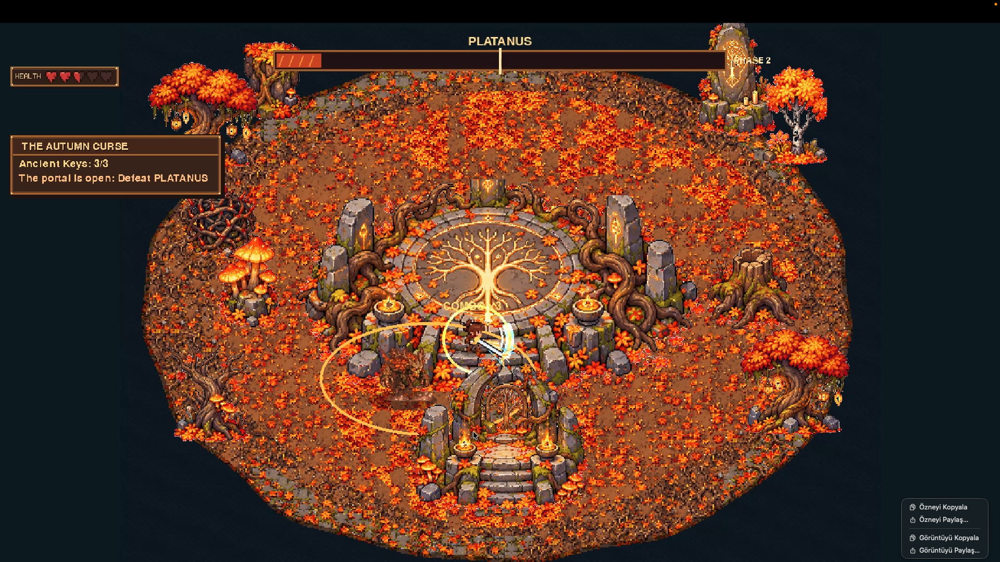
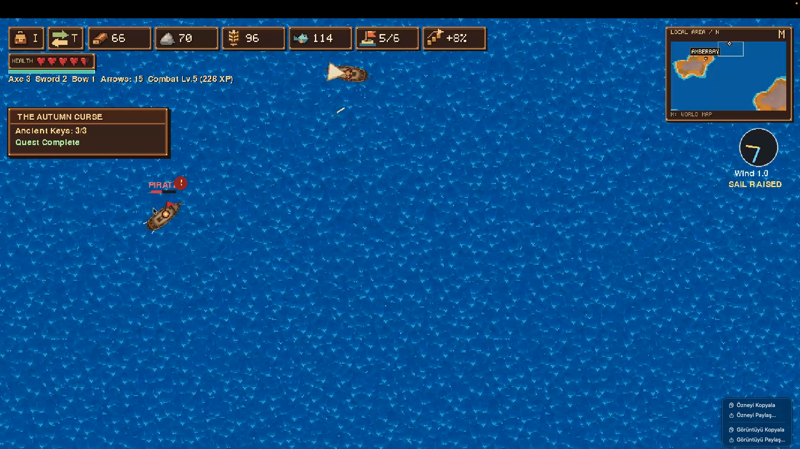
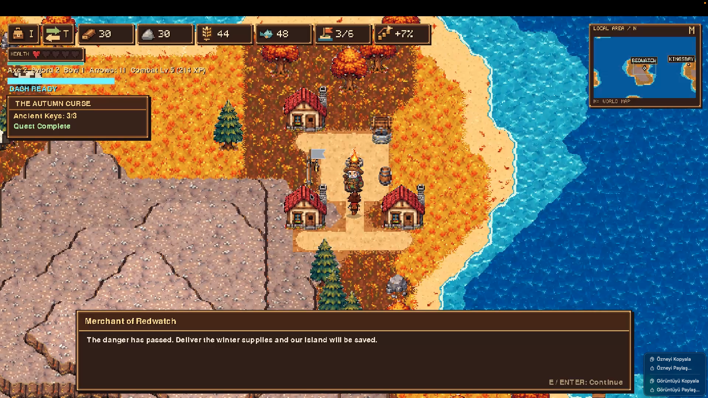

<div align="center">

# 🍂 Edge of Winter

**A pixel-art, autumn-themed multiplayer island adventure: sail between procedurally generated islands, build up your settlements, and break the Autumn Curse.**




</div>

---

## 📖 Table of Contents

- [About](#-about)
- [Screenshots](#-screenshots)
- [Features](#-features)
- [Controls](#-controls)
- [Getting Started](#-getting-started)
- [Running the Game](#-running-the-game)
- [Multiplayer](#-multiplayer)
- [Configuration](#-configuration)
- [Project Structure](#-project-structure)
- [Documentation](#-documentation)
- [Testing](#-testing)
- [Roadmap](#-roadmap)
- [Contributors](#-contributors)
- [Contributing](#-contributing)

---

## 🌲 About

**Edge of Winter** is a pixel-art game set in a world of autumn islands on the brink of winter. Every world is generated from a random seed using Perlin noise, so each archipelago has its own shape, terrain and layout. You explore on foot, sail the seas, fight pirates and bosses, and manage resources to prepare your people for the cold season.

The main quest, **The Autumn Curse**, sends you to collect three Ancient Keys, open the portal and defeat the guardian **Platanus**, then deliver the winter supplies to save the island.

The game is written in Python and is split into a game client (`main.py`) and a multiplayer server (`server.py`).

---

## 🖼️ Screenshots

| Boss fight: Platanus | Sailing the open sea |
|:---:|:---:|
|  |  |

| Settlement: Merchant of Redwatch |
|:---:|
|  |

---

## ✨ Features

- 🏝️ **Procedural islands:** Perlin-noise terrain generation driven by a seed. The same seed always gives the same world.
- ⛵ **Sailing and naval combat:** raise the sail, ride the wind and face pirate ships at sea.
- 🌳 **Boss fights:** multi-phase encounters such as **Platanus**, guardian of the Autumn Curse.
- ⚔️ **Combat and skills:** axe, sword and bow with arrows, a combat level with XP, and a dash ability.
- 🏘️ **Settlements and NPCs:** towns like Amberbay, Redwatch and Kingsbay with merchants and quest givers.
- 🪵 **Resource management:** wood, stone, wheat and fish, plus population and bonus tracking.
- 🗺️ **HUD, minimap and world map:** local area minimap with a full world map.
- 📜 **Quests:** an in-game quest tracker with objectives such as collecting Ancient Keys.
- 👥 **Multiplayer:** a dedicated server lets several players share one world.
- 💾 **Save system:** save files with automatic backups and seed-based worlds.
- ✅ **Validation and tests:** dedicated `validation/` and `tests/` folders.

---

## 🎮 Controls

| Key | Action |
|---|---|
| `I` | Open inventory |
| `T` | Open trade |
| `M` | Open world map |
| `E` / `Enter` | Interact, continue dialogue |

> Movement, attack and dash keys: see `settings.json` and the in-game help.

---

## 🚀 Getting Started

### Requirements

- Python 3.9 or newer
- `pip`

### Installation

```bash
# 1. Clone the repository
git clone https://github.com/meymenberk/Edge-of-Winter.git
cd Edge-of-Winter

# 2. (Recommended) create a virtual environment
python3 -m venv venv
source venv/bin/activate        # Windows: venv\Scripts\activate

# 3. Install dependencies
pip install -r requirements.txt
```

---

## ▶️ Running the Game

```bash
python main.py
```

---

## 🌐 Multiplayer

Start the server first, then launch the game on each player's machine:

```bash
# Terminal 1: start the server
python server.py

# Terminal 2 (and on other machines): start the game
python main.py
```

For players on other networks, the server's port must be reachable (port forwarding or a VPN such as Tailscale or ZeroTier).

---

## ⚙️ Configuration

Game options live in `settings.json`. Edit the file while the game is closed.

World generation uses a **seed**. The same seed always produces the same world, which is handy for sharing a world with friends or reproducing a bug.

> Save files (`savegame*.json`) are local and are not tracked by Git.

---

## 🗂️ Project Structure

```
Edge-of-Winter/
├── main.py              # Game client entry point
├── server.py            # Multiplayer server
├── settings.json        # Game settings
├── requirements.txt     # Python dependencies
├── docs/                # Design documents and images
│   └── images/          # README screenshots
├── tests/               # Automated tests
├── validation/          # Validation scripts
└── README.md
```

---

## 📚 Documentation

Detailed design notes are in the [`docs/`](docs/) folder:

| Document | Topic |
|---|---|
| [ASSET_STRUCTURE.md](docs/ASSET_STRUCTURE.md) | How game assets are organized |
| [MODULE_STRUCTURE.md](docs/MODULE_STRUCTURE.md) | Code modules and how they fit together |
| [WORLD_RENDERING.md](docs/WORLD_RENDERING.md) | How the world is drawn |
| [CHARACTER_ELEVATION.md](docs/CHARACTER_ELEVATION.md) | Character height on uneven terrain |
| [HUD_MAP_LEAVES.md](docs/HUD_MAP_LEAVES.md) | HUD, minimap and falling leaves |
| [TREANT_INTEGRATION.md](docs/TREANT_INTEGRATION.md) | Treant creatures in the world |

---

## 🧪 Testing

```bash
python -m pytest tests/
```

---

## 🛣️ Roadmap

- [ ] Game trailer
- [ ] More islands, biomes and events
- [ ] Improved multiplayer stability
- [ ] More bosses and quests
- [ ] Packaged builds for Windows and macOS

---

## 👥 Contributors

<table>
  <tr>
    <td align="center">
      <a href="https://github.com/meymenberk">
        <br>
        <sub><b>Eymen Berk</b></sub><br>
        <sub>@meymenberk</sub>
      </a>
    </td>
    <td align="center">
      <a href="https://github.com/00TheHuman00">
        <br>
        <sub><b>İlker Zelyurt</b></sub><br>
        <sub>@00TheHuman00</sub>
      </a>
    </td>
    <td align="center">
      <a href="https://github.com/cevherdonmez">
        <br>
        <sub><b>Cevher Dönmez</b></sub><br>
        <sub>@cevherdonmez</sub>
      </a>
    </td>
    <td align="center">
      <a href="https://github.com/MrAaz">
        <br>
        <sub><b>Arda Zelyurt</b></sub><br>
        <sub>@MrAaz</sub>
      </a>
    </td>
  </tr>
</table>

---

## 🤝 Contributing

Contributions are welcome.

1. Fork the repository (or ask to be added as a collaborator)
2. Create a branch: `git checkout -b feature/my-feature`
3. Commit your changes: `git commit -m "Add my feature"`
4. Push the branch: `git push origin feature/my-feature`
5. Open a Pull Request

Please run the tests before opening a pull request.

---

<div align="center">

*Made with 🍂 and Python.*

</div>
